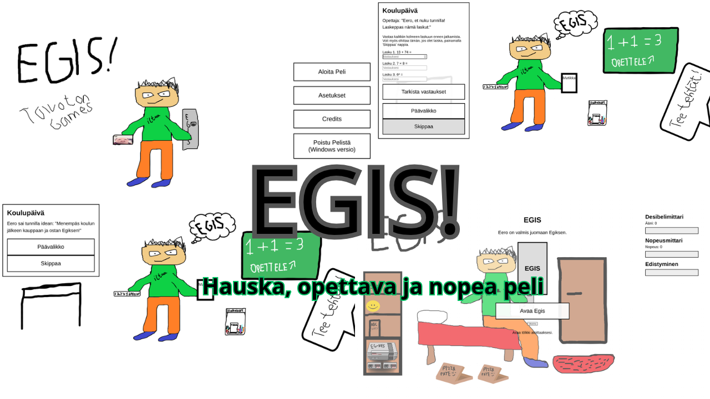

  

# Egis 
Toivoton Gamesin (Ei niin vakava firma) kehittämä todella laadukas peli.
Suomalainen, koukuttava, nopea, jatkuvasti päivityksiä :OOOOOO
## Pelin Idea:
- Tavoitteena on juoda Egis juoma mahdollisimman nopeaa ja hiljaa.
## Pelin Kulku:
- Pelin päähenkilö Eero miettii koulussa Egistä ja sen mahtavuutta ja miettii, että ostaako sen.
- Vaikka Eeron vanhemmat ovat kieltäneet Egisten juonnin hän päättää silti ostaa sen ja viedä sen hänen huoneeseen.
- Eero on huoneessaan, Eeron pitää avata megis hiljaa ja juoda se pitämättä ääntä.
- Jos Eero saa juotua Egiksen hiljaa, ilman että vanhemmat kuulee, läpäiset pelin.
- Jos vanhemmat kuulevat, he tulevat huoneeseen ja isä rankaisee.
## Ohjeet pelaamiseen:
- Paina "Aloita Peli"
- Laske laskut ja osta egis ja lopuksi juo se!

## Credits:
- Toivo
- Feeli
- Refresco Benelux
- Refresco Finland
- S-Kaupat Suomi
